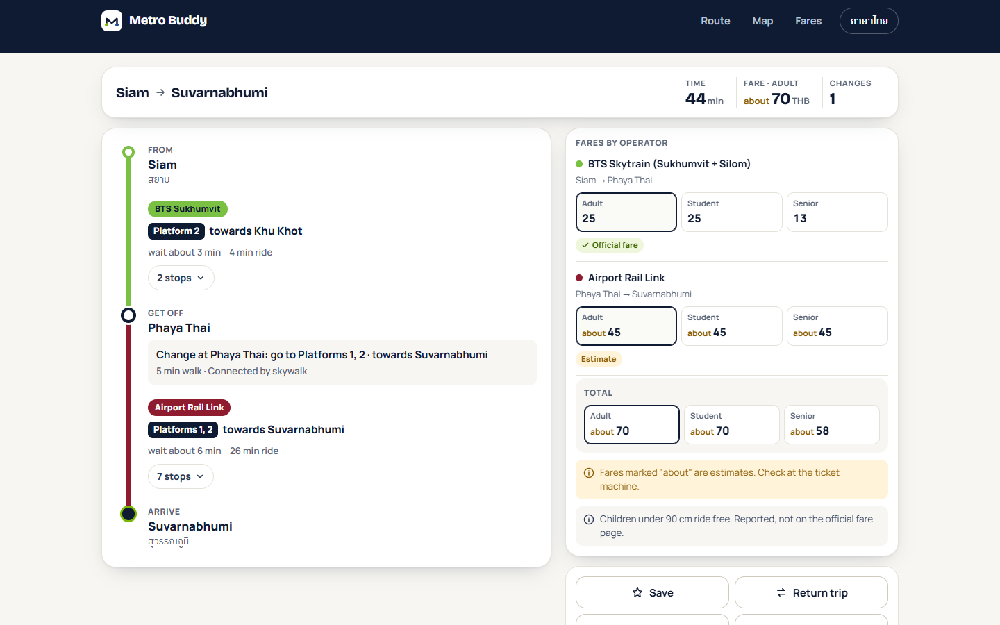
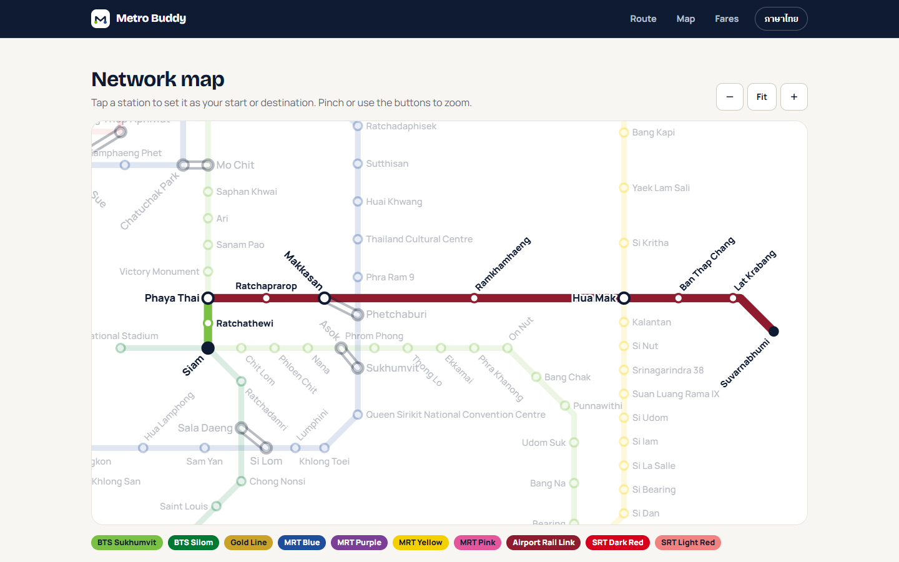
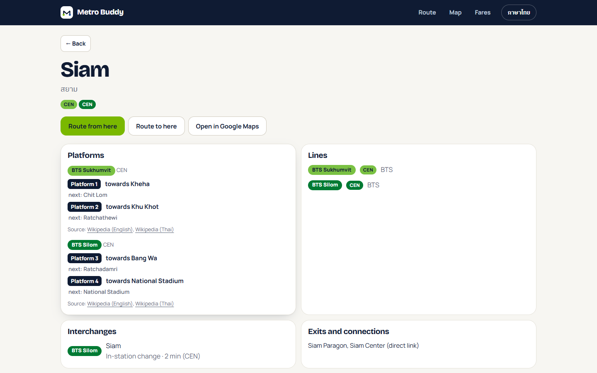
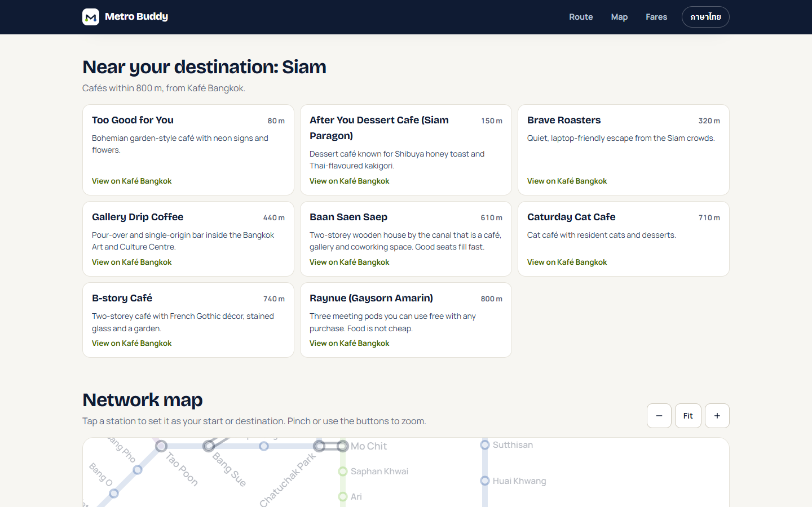
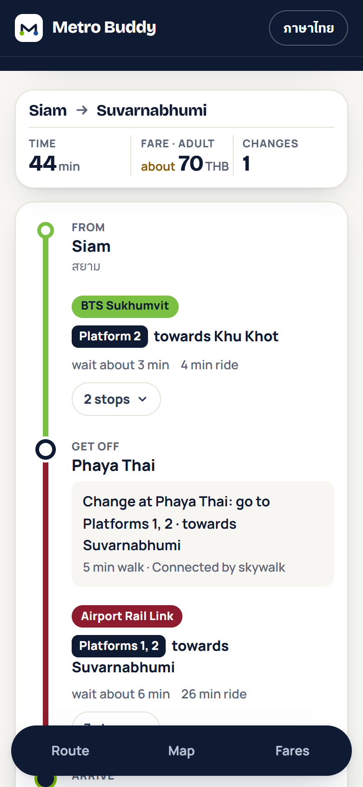

# Metro Buddy

**A Bangkok rail route finder, with fares for every passenger type and the right platform for every ride.**

**Live demo: [metro-buddy.pages.dev](https://metro-buddy.pages.dev)**

Metro Buddy covers all 10 urban rail lines in Bangkok: BTS Sukhumvit, Silom and Gold, MRT Blue, Purple, Yellow and Pink, the Airport Rail Link, and the SRT Dark and Light Red lines. That's 195 stations. Pick two stations and it shows the fastest route, a step-by-step timeline with platform numbers, and the fare for adults, students and seniors. It works in English and Thai.

It's built with plain HTML, CSS and JavaScript: no framework and no build step. A small backend (Cloudflare Pages Functions and a D1 database, in `functions/`) adds live service alerts, "Report a problem" and anonymous usage counts. I built it as a portfolio project.



## Screenshots

| | |
|---|---|
|  |  |
| *Schematic network map; the route is highlighted after a search* | *Station pages: platforms with sources, lines, interchanges and exits* |
|  |  |
| *Cafés near your destination, from my other project, Kafé Bangkok* | *Mobile first: the same route on a phone* |

## Features

- **Station search in English or Thai.** It accepts common spellings ("Asoke", "Thonglor") and station codes ("E4", "BL22"), and can find the station nearest to you with browser geolocation.
- **Fastest route, plus a fewest-changes route** when that one is different.
- **Timeline like a transit app.** Line pills in the official colours, each stop, and the platform and direction for every ride and change ("Change at Phaya Thai: go to Platforms 1, 2 · towards Suvarnabhumi").
- **Fares for adults, students and seniors,** split by operator, with a clear label on each: *Official fare*, *Checked at station*, or *about X THB* for estimates.
- **Network map** drawn in SVG. Tap a station to set it as From or To, zoom with pinch, ctrl+scroll or the buttons, and see the route highlighted.
- **Station pages** with platforms, lines, interchanges, exits, nearby cafés and a Google Maps link.
- **Cafés near your destination,** within 800 m, from my other project [Kafé Bangkok](https://kafe-bangkok.pages.dev).
- **Shareable links** (`#from=mo-chit&to=siam`, or codes: `#from=N8&to=CEN`), a one-tap return trip, and recent and saved routes stored in the browser.
- **Service alerts.** Delays and closures posted from my admin dashboard show at the top of the site within a minute, and on every route and station page they affect, in English and Thai.
- **Report a problem.** Riders can report a wrong fare, platform or exit from any route or station; a confirmed fare report becomes a checked fare in `data/fare-checks.json`.
- **Mobile first and accessible.** It meets WCAG AA contrast and works from 380px phones up to desktop.

## How the route finding works

The network is a graph, and the app finds the cheapest path through it with **Dijkstra's algorithm** (`js/route.js`).

- **Each station on each line is a node.** Siam is two nodes, one on the Sukhumvit Line and one on the Silom Line, because changing between them takes time.
- **Edges cost minutes.** Riding to the next station costs that line's average running time. Changing lines costs the walk between platforms plus the average wait for the next train.
- **Start and end are special nodes.** The search starts from a pretend "start" node linked to every platform at your station, including ones a short walk away. So a trip from Asok can begin by walking to MRT Sukhumvit if that's quicker.
- **Dijkstra's algorithm** always extends the cheapest path found so far, so the first time it reaches the destination, that route is the fastest.
- **Fewest changes:** the search runs again with a huge penalty on every change. It then cuts the number of changes first, and the minutes second.

Times are averages that include an average wait, and the site says so.

## How the fares work

Each operator in Bangkok charges separately, so `js/fares.js` splits a route into **fare journeys**: back-to-back rides on the same operator (for example BTS Sukhumvit to Silom at Siam). Each journey is priced from the station where you tap in to the one where you tap out. Then the journeys are added up.

- **Official tables first.** BTS, MRT Yellow and the SRT Red lines use the operators' published station-to-station tables. MRT Blue uses the official fare by number of stations, and Purple a station-to-station table. These are stored with their source links and effective dates in `tools/sources/fares/`.
- **Rules where there's no table.** The Gold Line is a flat fare, and the Pink Line is priced by distance. The Airport Rail Link uses known fares between pairs of stations.
- **Every fare is labelled honestly.** A fare is *official* (from an operator's table or rule), *checked* (checked by hand at a ticket machine, in `data/fare-checks.json`) or an *estimate*. Estimates always show as "about X THB" with "check at the ticket machine". The app never shows a guess as an exact price.
- **All three passenger types** (adult, student, senior) appear on every route, each with its own label. For example, MRT senior fares are official, but student fares are estimates because no official student discount is published.

Platform numbers follow the same rule. They're used only where a source confirms them and they match the network (the next station has to line up). Otherwise the app shows the direction only ("towards Kheha"). It never guesses.

## Tech used

- **HTML, CSS and JavaScript** (ES modules). No framework, no build step and no runtime dependencies.
- **SVG** for the network map, with automatic label placement (`js/map-layout.js`, `js/labels.js`).
- **Node.js** for the data build script and the test suite (86 tests: routes, fares, fare checks, platforms and data integrity).
- **Cloudflare Pages** hosting, with a small Pages Function (`functions/kafe/cafes.json.js`) that loads the café list from Kafé Bangkok on the same origin.
- `localStorage` for recent and saved routes, and Google Fonts (Bricolage Grotesque, Manrope, IBM Plex Sans Thai).

## Data sources and credits

- **Fares:** official fare tables and notices from BTS (station-to-station PDFs, effective 1 Nov 2025), the Royal Gazette (MRT Blue and Purple, effective 3 Jul 2026), EBM (MRT Yellow) and SRTET (SRT Red lines). The estimates for the Gold Line, Pink Line and Airport Rail Link come from news and travel sources, which are named in the data and marked as estimates. Every source is listed with a link in `data/transit.json`.
- **Platforms:** station layouts from Wikipedia, in English and Thai, checked against the network. Each station records the exact article revisions it came from (see `tools/platform-research/`).
- **Stations and coordinates:** compiled for this project. Coordinates are approximate.
- **Cafés:** [Kafé Bangkok](https://kafe-bangkok.pages.dev) ([source](https://github.com/dilshangulati07/kafe-bangkok)).
- **Hero photo:** [BTS SkyTrain](https://commons.wikimedia.org/wiki/File:BTS_SKY_TRAIN_(8).jpg) by PEAK99, [CC BY 3.0](https://creativecommons.org/licenses/by/3.0/), via Wikimedia Commons. Cropped and resized to WebP and JPEG by `tools/optimize-hero.py`. The files in `images/` are under the same licence.
- Line names and colours belong to their operators. This is an independent project, not affiliated with BTS, BEM, MRTA, EBM, SRT or the Airport Rail Link.

Always check fares and platforms at the station.

## Run locally

The app uses absolute paths (`/js/app.js`), so serve the folder as the site root:

```bash
git clone https://github.com/dilshangulati07/metro-buddy.git
cd metro-buddy
python -m http.server 8080      # or: npx serve .
```

Then open http://localhost:8080. The café section loads through a Cloudflare Pages Function that only runs on the live site (or with `npx wrangler pages dev .`), so with a plain local server it stays hidden. Everything else works.

Run the tests (Node 18+):

```bash
node tests/run.mjs
```

After editing anything in `tools/`, rebuild the data and test again:

```bash
node tools/build-data.mjs
node tests/run.mjs
```

## Project structure

```
index.html, 404.html     pages
css/styles.css           all styles (mobile first)
js/route.js              Dijkstra route finder (pure, commented step by step)
js/fares.js              fares per operator and passenger type (pure)
js/platforms.js          platform and direction for each ride (pure)
js/map.js, map-layout.js, labels.js   SVG network map
js/app.js, i18n.js, cafes.js, geo.js, storage.js   UI, English/Thai, cafés, helpers
data/transit.json        stations, lines, travel times, fares, platforms (built)
data/fare-checks.json    fares checked at ticket machines
tools/                   data build script, official fare tables, platform research (not deployed)
tests/run.mjs            test suite (not deployed)
```

## Deploy

It's a static site on Cloudflare Pages (https://metro-buddy.pages.dev), connected to this repo, so every push to `main` deploys it. There's no build command and the output directory is `/`. `_headers` sets the security and cache headers, and `functions/kafe/cafes.json.js` serves the café list. (`netlify.toml` is the old Netlify setup and isn't used.)

---

Built by **Dilshan Gulati** · [Portfolio](https://dilshangulati.pages.dev) · [Kafé Bangkok](https://github.com/dilshangulati07/kafe-bangkok)
